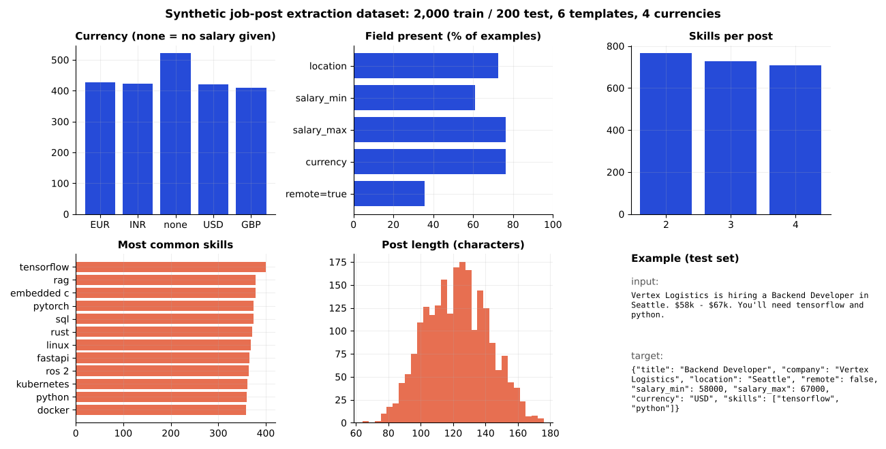

# 04 · Fine-tune a small LLM (QLoRA on a free T4)

Teach a 0.5B model a job it's bad at out of the box: turning messy job posts into **clean, exact JSON**. Then prove it with a **before/after eval** on held-out data.

```
"[Nimbus Robotics] Robotics Software Engineer - Manchester / remote - £55k - £70k - skills: ros 2, c++ and docker"
                                     ↓  Qwen2.5-0.5B-Instruct + LoRA
{"title": "Robotics Software Engineer", "company": "Nimbus Robotics", "location": "Manchester", "remote": true,
 "salary_min": 55000, "salary_max": 70000, "currency": "GBP", "skills": ["ros 2", "c++", "docker"]}
```



## Run it (free Colab T4, ~30 min)

Open [`notebooks/colab_finetune.ipynb`](notebooks/colab_finetune.ipynb), choose **Runtime → T4 GPU**, and run all cells. Or step by step:

```bash
pip install -r requirements.txt
python -m finetune.data --train 2000 --test 200                     # synthetic, deterministic, labels verified
python -m finetune.evaluate --model Qwen/Qwen2.5-0.5B-Instruct --tag base
python -m finetune.train --config configs/qlora_t4.yaml             # --dry-run to see the plan first
python -m finetune.evaluate --model Qwen/Qwen2.5-0.5B-Instruct \
    --adapter outputs/qwen0.5b-jobs-lora/adapter --tag finetuned
python -m finetune.evaluate --compare results/base.json results/finetuned.json --readme README.md
```

## Results

<!-- RESULTS:START -->
*Run the notebook; `--compare ... --readme README.md` writes the before/after table here.*
<!-- RESULTS:END -->

Metrics, on 200 held-out examples:
- **valid JSON %:** did it output parseable JSON at all?
- **exact match %:** every field correct (after normalising case, number formats and skill order)
- **field accuracy %:** mean per-field accuracy across the 8 fields
- **skills F1:** set overlap on the skills list

## How it works

| piece | choice | why |
|---|---|---|
| base model | `Qwen/Qwen2.5-0.5B-Instruct` (or Llama-3.2-1B) | fits a T4 with room to spare; weak at strict JSON, so the gain is visible |
| method | **QLoRA**: 4-bit NF4 base + LoRA r=16 on all attention + MLP projections | trains ~1% of parameters; ~5 GB GPU memory |
| trainer | TRL `SFTTrainer` on chat-formatted `messages` | the model's own chat template, same as at inference |
| precision | fp16 (the T4 has no bf16), gradient checkpointing | fits the free GPU |
| data | 2,000 synthetic posts: 6 templates, 4 currencies, missing fields, remote/onsite | deterministic (seeded), deduplicated, and tests check every label against its text |

The data generator is tested so labels can't drift from the text. The test caught a template that dropped the city while the label still had one, which would have taught the model to make up locations.

## Serve the fine-tuned model

The adapter works with **03-deploy** directly:

```bash
vllm serve Qwen/Qwen2.5-0.5B-Instruct --enable-lora --lora-modules jobs=outputs/qwen0.5b-jobs-lora/adapter
python -m finetune.evaluate --backend openai --base-url http://localhost:8000/v1 --model jobs --tag served
```

Or merge it into the base weights and push to the Hub: `python -m finetune.merge --base ... --adapter ... --push <user>/qwen0.5b-job-extractor`.

## Tests

`python -m finetune.figures` regenerates the dataset figure. `pytest` (7 tests, no GPU): dataset determinism, uniqueness and label consistency; JSON parsing (fenced, chatty); metric normalisation; eval runner with oracle and naive predictors; config and training plan.

## What I learned

LoRA / QLoRA · 4-bit quantisation · chat templates · SFT · held-out evaluation · adapter serving
